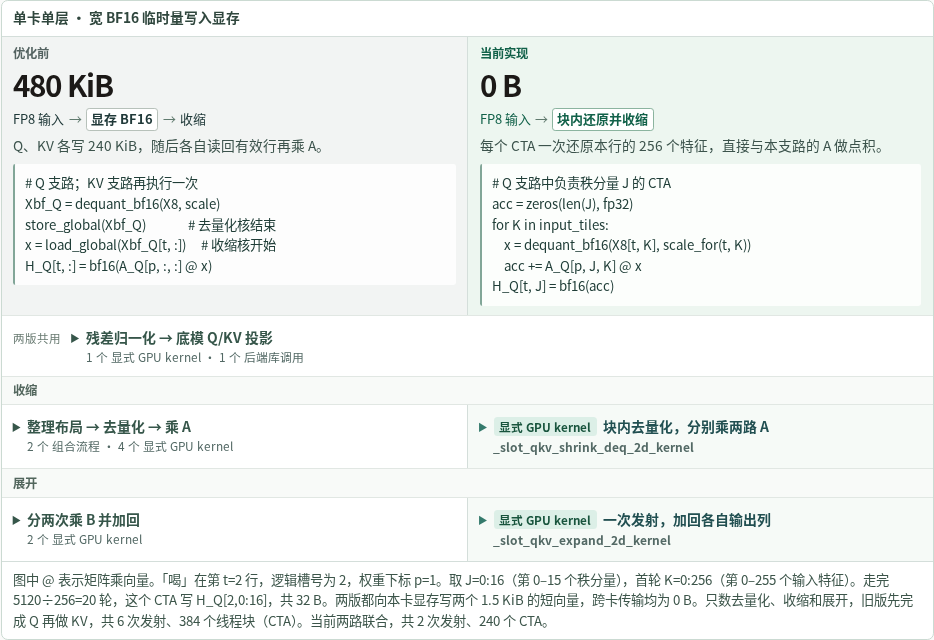

# 一轮多 LoRA Decode 的 kernel 对照

从草稿提议到验收，沿九步前向追踪请求甲的第三个验证位置「喝」。沿页面向下读，就能看到每一步做什么、六处改动怎样影响下一步。Q/KV 的显存写入对照、验收的逐词例子和单卡开销都可以直接读。点算子名就能逐项查看 Input、伪代码、Output、CTA 分工与通信。在 GitHub 文件页选择 **Download raw file**，再用浏览器打开保存的 HTML。[打开离线示例文件](index.html)

要为另一个算子写同样的说明，复制一张空白卡，选一个实际位置和一个 CTA，把同一组下标从 Input 一直用到 Output。博客使用共用的 HTML 渲染函数排出这些字段。[复制 Markdown 模板](../../assets/kernel-card.md) · [查看 HTML 渲染函数](../../scripts/kernel_card.py)

## 第 3 步怎样省掉 480 KiB 写入？

Q 和 KV 使用同一行输入。在旧实现中，两路各向显存写一张完整的 BF16[24,5120]，每张 240 KiB，随后各自的收缩核再读取有效行。当前实现直接在收缩的线程块里还原 FP8 输入，两路的宽 BF16 临时写入合计降至 0 B。



点开当前实现的 `_slot_qkv_shrink_deq_2d_kernel`。下面跟踪一个 CTA，为位置「喝」计算 Q 的前 16 个秩分量。

**Input**

| 变量及含义 | 本例取值 | 取值原因 |
| --- | --- | --- |
| `t` · 验证批中的行号 | `t=2` | 请求甲排在第一个，六行从 0 编号，「喝」是第三个位置。 |
| `slot[t]` · 该行请求的逻辑槽号 | `slot[2]=2`，物理权重下标为 1 | 甲挂在逻辑槽 2。槽 0 给底模，线性层权重表从下标 0 存放正槽。 |
| `X` · 本层注意力的量化隐藏状态 | 首轮取 `X[2,0:256]`，256 B | 这张卡的 Q 收缩核每轮处理 256 个输入特征。 |
| `scale_for` · 取对应特征组的量化比例 | 同一行前 8 个组，共 8 B | 本例每 32 个特征共用一个指数，256÷32=8。 |
| `A_Q` · 本层 Q 支路的收缩权重 | 首轮取 `A_Q[1,0:16,0:256]`，8 KiB | 选负责前 16 个秩分量的 CTA。该切片含 16×256 个 BF16 系数。 |

```text
acc = zeros(16, fp32)
for k in range(0, 5120, 256):
    x = dequant_bf16(X[2, k:k+256], scale_for(2, k:k+256))
    acc += A_Q[1, 0:16, k:k+256] @ x
H_Q[2, 0:16] = bf16(acc)
```

**Output**　这个 CTA 累加 20 轮，向本卡显存写 `H_Q[2,0:16]`，16 个 BF16 共 32 B。展开核稍后会读取它。

**CTA 分工**　一个 CTA 负责一个位置、一个分支和 16 个秩分量。这个 batch 有 24 行，两条分支各分两个秩块，共发射 24 × 2 × 2 = 96 个 CTA。其中 18 行启用 LoRA，72 个块做点积，另 24 个块向短向量写零。行号与槽号来自这批请求，5120 取自模型输入宽度，256 和 16 取自该核的分块。

**显存与通信**　当前核在 CTA 内将输入还原为 BF16，并将 Q、KV 的两个短结果写回本卡显存，各为 `[24,32]`、1.5 KiB。该核跨卡传输 0 B。

## 第 7 步为什么会列出五项？

旧版的“收缩”把两条分支的相关源码调用列在一起。路由分支有一个显式 Triton 收缩核。共享分支先用 `mm` 求出所有槽的短向量，再从槽号匹配表准备掩码，依次调用 `to(BF16)` 和 `repeat_interleave`。最后 `mul_` 把短向量与掩码逐元素相乘。实际调用顺序中，路由分支先完成自己的展开和按槽求和，才进入共享分支。旧版报告缺少把这五个调用逐项映射到 GPU 发射的记录。

以「喝」为例，它占第 2 行，使用物理槽 1。共享 `mm` 为这行写 16 个槽 × 32 个秩分量，合计 512 个 BF16。`mul_` 之后，列 `32:64` 留下物理槽 1 的 32 个数，其余列清零。可以在“专家 down → 收缩”的左栏逐项查看变量、切片和取值依据。

## 同步博客更新

此案例取自 `cp4-compression-and-multi-lora-decode.html` 的 `#decode-comparison`。维护这张博客对照页时，在同一轮修改中从定稿 HTML 更新 `index.html` 和 `qkv.png`。网页里的批量、形状、分块和统计口径也随正文导出。

在 skill 仓库根目录运行下列命令，将第一个参数替换为定稿的博客 HTML 路径。生成 HTML 使用 Python 3，截取预览需要 Playwright、Chromium 和支持中文的字体。

```sh
python3 scripts/export_decode_example.py /path/to/cp4-compression-and-multi-lora-decode.html \
  examples/decode-comparison/index.html --preview examples/decode-comparison/qkv.png
```

打开导出页，直接读完九步流程，再任选一个算子核对其输入、输出和通信。在手机宽度和离线环境下检查改动涉及的交互，将有变化的示例文件同步到本仓库。
