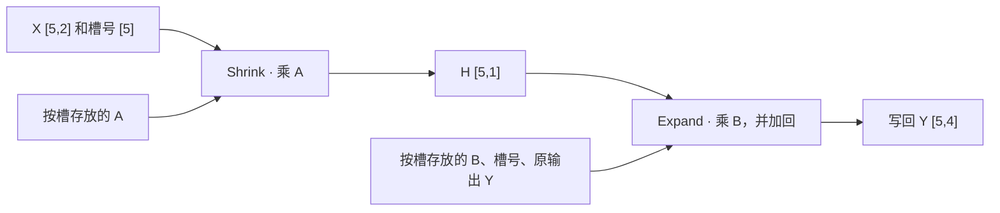

# 案例：同一批投影的两种 CTA 分工

这是独立的小矩阵算例。每行对应一个输入项，输出列对应同一输入项的不同结果。权重槽号选一套权重。示例把中间向量缩到一个数，并把原输出初始化为零。

## 先画发射依赖



令前 3 行用槽 1，第 3 行用槽 2，第 4 行为底模行（槽 0）。取 `X=[[2,3],[1,4],[3,0],[2,4],[9,9]]`。A1 取第一个数，A2 取第二个数，得到 `H=[2,1,3,4,0]`。

```python
# Shrink 教学伪代码。grid = (5,)，每个 CTA 写自己的一个 H。
t = program_id(0)
s = slots[t]
H[t] = dot(X[t], A[s]) if s > 0 else 0
```

## 从输出坐标反推 expand 的分工

B1 为 `[10,1,2,3]`，B2 为 `[1,2,3,4]`。设每个列块有 2 列。

| 网格和坐标 | CTA 读什么 | CTA 写什么 |
| --- | --- | --- |
| 一维 `(5,)`，块 0 | H[0]，依次读同槽 B1 的两个列块 | 行 0 的列 0–3 |
| 二维 `(2,2)`，块 (0,0) | H[0:3]，共读一次 B1 的列 0–1 | 行 0–2 的列 0–1 |
| 二维 `(2,2)`，块 (0,1) | 同样三行 H，共读一次 B1 的列 2–3 | 行 0–2 的列 2–3 |
| 二维 `(2,2)`，块 (1,0) | 行 3 查 B2，行 4 跳过，行 5 越界 | 行 3 的列 0–1 |

```python
# 一维 expand。每个 CTA 横着扫完一行。
t = program_id(0)
s = slots[t]
if s > 0:
    for cols in ((0, 1), (2, 3)):
        Y[t, cols] += B[s, cols] * H[t]
```

```python
# 二维 expand。两个 program ID 分别选择行组和列块。
row_group, column_group = program_id(0), program_id(1)
rows = valid_rows(3 * row_group, count=3, limit=5)
cols = two_columns(column_group)
if len(rows) == 3 and same_positive_slot(rows):
    b = load(B[slots[rows[0]], cols])      # 同一块 B 供三个 H 使用
    for t in rows:
        Y[t, cols] += b * H[t]             # 三处独立写入
else:
    for t in rows:
        if slots[t] > 0:
            Y[t, cols] += B[slots[t], cols] * H[t]
```

两路都得到 `[[20,2,4,6],[10,1,2,3],[30,3,6,9],[4,8,12,16],[0,0,0,0]]`。对同槽前三行和列 0–1，一维由三个 CTA 各取一次 B，二维由一个 CTA 取一次并做三份计算。这个小例子用于验证分工、写回和回退。显存流量由缓存命中决定，性能要在目标形状和设备上测量。
